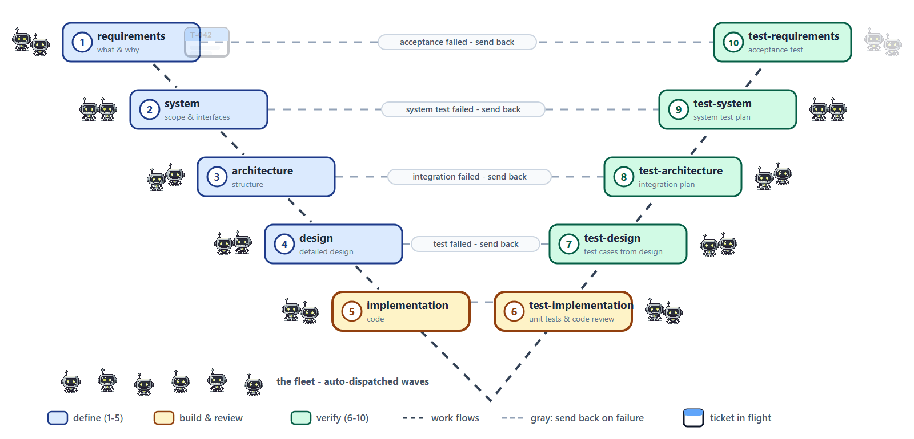

# 🔱 Hephaestus

[](https://github.com/McNopper/Hephaestus/actions/workflows/verify.yml)

> **Early stage + token warning.** This is early-stage software - expect rough
> edges and rapid change. It also **burns tokens**: every dispatched ticket runs
> real agent sessions (a worker run, plus a review pass per ticket), and long
> waves multiply that fast. Unattended waves are therefore **opt-in** - nothing
> runs on its own until you arm the ticker (*Install & Use*, last step), and then
> only inside its spawn cap and cost budget. Use the ticket `model` field as the
> cost lever (small, well-specified tickets deserve cheap models), dispatch by
> hand where you can, and let automation run only what pays for itself.

## About this document

- **Kind:** `doc` / repo README (top-level entry point)
- **Read by:** humans evaluating/adopting the template; **written by:** maintainers
- **Related:** pairs with `AGENTS.md` (workflow conventions) and the skill/agent set under `.opencode/`

> *[Hephaestus](https://en.wikipedia.org/wiki/Hephaestus) — Greek god of the forge, and the one who built automatons: Talos, the golden mechanical attendants.*



*What you see: the ten-stage V-model - the blue **definition leg (1-5)** steps down,
the amber **build/review vertex (5-6)** joins them, the green **verification leg (6-10)**
climbs back up. **One ticket** walks the whole V while **agent crews** (the mascots)
appear and disappear where the work is; the six bots waiting at the bottom are
mascots - the fleet they belonged to was removed in U-110. The dashed connectors march in the direction of travel, and
the gray lines are the **send-back paths** (the pair lines name the failing
check, e.g. "system test failed - send back"; the legend keys the gray
dashes - rejection at the vertex included). The same flow drives the
Eclipse Board's
V-pipeline and the ticker's waves.*

## Overview

Hephaestus is an **opencode-native** template for **agentic project management and
software development** - in the project's framing, an **automated ASPICE-style
V-process using software agents**: the ten-stage V-model with persistent stage
artifacts (machine-gated at exit), automatic top-down coverage, evidence-based
readiness and horizontal defect loops (see `docs/spice-alignment.md`). You add the
requirements; the harness forces everything below.

The requirements define the **scope**: sub-scopes decompose along basis links, and
work *inside* the scope runs itself in cyclic waves - a maintainer only jumps in
when the scope itself must grow (`clarification:` exhausted -> NEEDS-HUMAN). The
produced artifacts - requirements, architecture diagrams, design docs, test
evidence - stay ordinary readable documents, so a human can overview the whole the
pre-AI way.

Three things make up the harness: a concrete, Scrum-like **ticket** workflow over
the **task store** (`.harness/tasks/`, one Markdown file per ticket per project)
served as `task_*` MCP tools by the Eclipse harness's `eclipse-build` endpoint and
the stdio `tasks-tools` launcher (opencode prefixes them with the server name -
`tasks_task_*` in TUI sessions, `eclipse-build_task_*` in Eclipse; the tool/wire
names stay `task_*`); a skill and agent library organized by **domain** (flat under
`.opencode/`, named `<domain>-<descriptor>` - not by lifecycle or folder tree); and
a first-class C++ **tool lane** - the token-authed `eclipse-build` MCP endpoint
serves the `cmake_*`/`ctest_run`/`debug_batch` pack over `cpp/`, not a separate
lifecycle (the specialized `cpp-tools` agent and the graphics MCP server left the
repo in the 2026-10-15 curation, see AGENTS.md).

**Start here:** *Install & Use* (further below) is the first-run path - setup,
build, run, then arm the ticker for unattended work - and the **Guides** table in
the next section picks up the detailed how-tos.

Three ideas hold it together:

- **Domains in names, not folders.** opencode discovers every `SKILL.md` under
  `.opencode/skills/*/`. Naming convention `<domain>-<descriptor>`
  (`software-`, `test-software-`, `project-manager-`, plus the cross-cutting
  `stage-pipeline`); coordination agents are
  unprefixed. Specialized `cpp-`/`graphics-`/`code-`/`research-` skills are
  setup-supplied, not in this repo (2026-10-15 curation).
- **A concrete PM, not a metaphor.** The `project-manager` agent runs Scrum over tickets in the
  task store. Tickets carry a `role` (discipline), and workers **self-claim** by role
  (`task_claim`). Multiple independent **projects** coexist as subdirectories of the
  store. The store is version-controlled Markdown — the seam the Maven mojos
  (`opencode-tasks:sync`/`plan`) and the Eclipse Board view build on.
- **Model-neutral by default.** Agents reference a *tier*; the concrete model
  resolves from YOUR `opencode.json` default and agent frontmatter — **no
  model ids are committed** (contributors use different providers; set your
  own, resolve via `/models`).

> **The PM/ticket system is optional.** Any skill or agent can be used **directly** by a
> human (or another agent) with no ticket - just invoke the skill or pick an
> agent with `/agents`. The PM system is there when you want tracked, multi-agent, ticket
> execution; skip it for ad-hoc work. Skills like `project-manager-doc-about` also work standalone,
> independent of PM.

## Guides

| Guide | What it is for |
|---|---|
| [`docs/TESTING.md`](docs/TESTING.md) | test guide - build, deploy and exercise the harness, and how to report what you find |
| [`eclipse/INSTALL.md`](eclipse/INSTALL.md) | install & run guide for the Eclipse harness (deploy, views, endpoints) |
| [`eclipse/QUALITY.md`](eclipse/QUALITY.md) | the code-quality gate every `.\build.ps1 verify` runs |
| [`docs/new-machine-setup.md`](docs/new-machine-setup.md) | setup runbook for bringing a fresh machine up |
| [`docs/own-project.md`](docs/own-project.md) | wiring the harness to YOUR own project (store layout, config, tickets, waves, gate) |

## What works with and without Eclipse

Everything here is **opencode-native first**: the *entire* agentic stack — board,
ticker, skills, agents — runs from a plain `opencode` TUI in this repository.
Eclipse is the optional human surface: overview, inspection, takeover. One
repository, two ways to use it:

| Capability | Plain opencode TUI (no Eclipse) | Eclipse harness (on top) |
|---|---|---|
| Skills, agents, model tiers (`/agents`, `/models`, Plan mode) | ✅ | ✅ — same engine, surfaced in views |
| **Task board** — `task_*` tools incl. `task_doctor` lint, V-pipeline, seven-state model | ✅ `tasks` stdio server (`eclipse/tasks-tools.ps1`) | ✅ **Board view** (kanban + pipeline, type badges, peer-write refresh) *and* the same tools via `eclipse-build` |
| ~~**Fleet**~~ — removed in U-110; the ticker-v schedule + goal-driven subagents replaced it | ✗ | ✗ (Board mirrors the store; no fleet view) |
| **Maven mojos** `opencode-tasks:sync` / `:plan` over the store | ✅ | ✅ |
| Graphics MCP (screenshot, RenderDoc, render comparison) — **not shipped in this repo**; user-supplied `mcp.graphics` since the 2026-10-15 curation (AGENTS.md) | ✅ | ✅ |
| `cpp-tools` agent driving CMake/clang tooling — **agent moved out of the repo** 2026-10-15 (user-supplied methodology) | ✅ (bash-driven) | ✅ |
| Structured C++ tool pack as MCP tools (`cmake_*`, `ctest_run`, `debug_batch`, …) | ❌ lives in Eclipse's `eclipse-build` endpoint | ✅ (per-start token auth) |
| Chat UI (markdown/KaTeX/mermaid, Stop, pending queue, late-reply recovery) | — the TUI *is* your chat | ✅ chat view |
| Server/Providers/Repo/Session views, live busy-session icons, CDT markers | ❌ | ✅ |
| Building this harness itself | `eclipse/build.ps1` (JDK 21, Maven/Tycho reactor) | same |

The split is deliberate architecture, not happenstance: the `client`, `tools`,
`tasks` and `git` bundles are **platform-free (UI/runtime)** — with one
deliberate exception: the Eclipse **JobManager** runtime (`org.eclipse.core.jobs` +
`equinox.common`) is allowed because both run in a plain JVM, and the engine uses the
same work scheduler (`WorkerPools`) in every host — the IDE
consumes them, never owns them (see `eclipse/ARCHITECTURE.md`).

## Manual or unattended

The harness works the same way either way round:

- **Manual (default):** you drive every step yourself - from **chat** (the
  opencode TUI or the Eclipse chat view) or by hand on the **Board** (claim a
  ticket, record its artifact, move its state). Nothing runs on its own.
- **Unattended:** arm the ticker (*Install & Use*, last step) and every tick
  walks the V in canonical order - resolving blocked tickets, dividing done ones
  into linked downstream tickets, kicking off ready ones - inside the spawn cap
  and the cost budget. That is the **token burner** from the warning above, so
  it stays opt-in.
- *History:* an earlier **fleet** subsystem (its own launcher, a Fleet view, a
  `fleet` flag in `opencode.json`) was removed in U-110 and replaced by the
  ticker - the capability table above keeps that row for the record.

## Layout

| Path | What it is |
|---|---|
| `opencode.json` (repo root) | project config - `AGENTS.md` routing and the `tasks` stdio launcher (the `fleet` launcher went away with U-110; the graphics MCP is setup-supplied, not shipped here). The model choice is setup-local: a user's own opencode.json (user-global) or an agent frontmatter `model:` may carry it - none is committed here (D-004). |
| `AGENTS.md` (repo root) | opencode-first workflow conventions and routing. |
| `.opencode/skills/*/SKILL.md` | the skill library, flat by domain. |
| `.opencode/agent/*.md` | lean custom agents (coordination + domain). |
| `.opencode/docs/` | `domains.md`, `contracts.md`. |
| `.harness/tasks/` | the **task store** — one Markdown file per ticket per project (`<project>/T-NNN.md` + `_meta.json` sidecar), version-controlled. |
| `mcp/` | graphics MCP server **moved out of the repo** (2026-10-15 curation → user-supplied `mcp.graphics`); the directory carries nothing tracked |
| `cpp/` | standalone AI-first C++23 build skeleton (its own `AGENTS.md`). |
| `eclipse/` | the Eclipse plugin — the agentic IDE harness (chat, Server view incl. **MCP servers + Skills**, Providers view with logos, the **PM Board**, the token-authed `eclipse-build` MCP endpoint serving the C++ **and** `task_*` tool packs, the `opencode-tasks` Maven plugin (`:sync`/`:plan` over the task store), the `tasks-tools.ps1` stdio launcher; Maven/Tycho reactor). |

## Skills (flat, by domain)

| Domain | Skills |
|---|---|
| `software-` (definition) | `software-requirements`, `software-system`, `software-architecture`, `software-design`, `software-implementation` |
| `test-software-` (verification) | `test-software-implementation`, `-design`, `-architecture`, `-system`, `-requirements` |
| `project-manager-` (project management) | `project-manager-operating-model`, `project-manager-orchestrate-execution`, `project-manager-route-request`, `project-manager-audit-traceability`, `project-manager-estimate-costs`, `project-manager-gather-intelligence`, `project-manager-create-ticket`, `project-manager-doc-about` |
| `stage-pipeline` (cross-cutting) | `stage-pipeline` (the linked-stage ticker procedure; armed by `ticker-setup.ps1`) |
| `code-`, `research-`, `cpp-`, `graphics-` | **setup-supplied, not in this repo** (2026-10-15 curation): they live in the installation's own skill library — `.opencode/skills` carries the 19 in-repo skills above |

Verification maps by composition level: `test-software-implementation` ↔ `software-implementation`
(unit), `test-software-design` ↔ `software-design` (component), `test-software-architecture`
↔ `software-architecture` (library), `test-software-system` ↔ `software-system` (integration),
`test-software-requirements` ↔ `software-requirements` (acceptance).

### Terminology (canonical in this repo)

The dividing line between **component** and **library** is **reuse scope**, not size and
not static-vs-shared linkage (that is a build decision):

| Term | Meaning | Reuse scope | Composes into |
|---|---|---|---|
| **Unit** | Smallest element with a clear interface; implementation fills its content. | within one component | Component |
| **Component** | Units behind a clear interface; **internal** to this software. | within this software | Library |
| **Library** | Components behind a clear interface; **reusable outside this software**. | reusable across systems | Software System |
| **Software System** | Integrated product of libraries + external interfaces. | the deliverable | — |
| **Package/Folder** | Organization only; a language *module* is also just organization. | — | — |

## The ticket workflow

The **task store** (`.harness/tasks/<project>/`, one Markdown file per ticket) holds
**tickets**, scoped per **project** so several independent projects run at
once. Agents read/write it through the `task_*` MCP tools; humans can read the files
directly (and hand edits are tolerated between tool writes). Ticket states:

```text
ready --claim--> in-progress --verify--> in-review --accept--> done
   (not-implemented = a DONE state reachable from any non-terminal state: decided not to build)
paused = dependency wait: born paused while the basis is open; auto-resumes when it completes
blocked = hard stop that propagates up the basis chain to the requirement; clearing walks back down
```

The rules below are the short, human version; the exact field-, state-, tool- and
review-level contract lives in [`.opencode/docs/contracts.md`](.opencode/docs/contracts.md)
(the canonical contract source).

Key rules:

- **Tickets are claimed, not assigned.** An agent asks `task_claim` for the next
  **ready** ticket in its role, and the claim is atomic, so two agents never get
  the same ticket. A released ticket (`task_release`) goes back to the queue for
  a different agent to pick up.
- **Work is handed over through artifacts.** Whoever did the work records what it
  produced - a file, a git commit, a doc - with `task_add_artifact` *before* the
  ticket moves to `in-review`; that artifact is what the review looks at.
- **Failed reviews rework, they do not close.** A review FAIL blocks the ticket
  **in its own stage** with the reviewer's reasons (the maintainer-escalation
  signal) and sends the problem back to the ticket's **basis** - the upstream
  link, whose stage then re-opens or reworks it; unstaged tickets stay blocked in
  place. An UNCLEAR verdict round-trips the doubt to the originator (one retry per
  stage visit).
- **Escalation bubbles up.** A blocked ticket carries a description of what blocks
  it; the project manager resolves what it can internally and escalates only the
  human-worthy decisions (NEEDS-HUMAN).

**V pipeline (optional, per ticket).** A ticket may carry a `stage` — the 10 canonical stages
`requirements` … `test-requirements` (definition down the left leg, verification up the right).
Stages run **concurrently** (no phase gates): each finished stage feeds the next stage
by division - the stage's ticker creates the linked downstream tickets (`basis` = the
completing ticket); a stage that cannot proceed blocks in place and escalates
to its basis. The Board view has a Pipeline mode for stage-ordered columns.

See `project-manager-operating-model` (Scrum events, DoD, escalation), `project-manager-create-ticket` (how to fill
a ticket), `project-manager-route-request` (ambiguous next step), `project-manager-audit-traceability` (matrix).

## Agents (lean, flat, model-neutral)

This is exactly what ships in [`.opencode/agent/`](.opencode/agent/) - 18 files, one per
row - and none of them carries a committed model (tiers resolve from your own setup; see
*Model tiers*):

| Agent | Role | Model |
|---|---|---|
| `orchestrator` | drives the autonomous workflow: orders tickets, dispatches each to the right worker at the tier's model, verifies, merges, iterates to convergence or the budget cap (edits automation artifacts only) | tier (`high`) |
| `manifest-author` | turns intent into a dependency-ordered plan plus a machine-readable execution manifest | tier (`high`) |
| `executor` | executes one atomic, well-scoped task from the manifest, runs its verification, returns a structured completion report - the default worker | tier (`low`) |
| `reviewer` | validates completed work against acceptance criteria and traceability, runs the review gate, triggers rework (edit-denied) | tier (`high`) |
| `rubberduck` | cross-vendor critic for `very-high` work - surfaces gaps, hidden dependencies, risky ordering (edit-denied, different vendor) | tier (different vendor) |
| `research` | investigates open questions with authoritative sources; synthesis plus a validated reference list | tier (`high`) |
| `project-manager` | always-present Scrum Master + Product-Owner proxy; owns the ticket workflow, refinement and the bubble-up-to-escalation rule | tier (`high`) |
| `product-owner` | the Product Owner's seat: registers requirements/bugs as tickets, verifies the machine's work with evidence, surfaces NEEDS-HUMAN - never implements (write/edit/patch/bash denied) | tier (setup-local) |
| `hephaestus-requirements` | `requirements` stage worker: fulfils ONE claimed ticket from its governing definitions, records the stage product as the ticket artifact, stops at in-review - the engine's review pass owns done | tier (setup-local) |
| `hephaestus-system` | `system` stage worker (same contract, its own stage) | tier (setup-local) |
| `hephaestus-architecture` | `architecture` stage worker (same contract, its own stage) | tier (setup-local) |
| `hephaestus-design` | `design` stage worker (same contract, its own stage) | tier (setup-local) |
| `hephaestus-implementation` | `implementation` stage worker (same contract, its own stage) | tier (setup-local) |
| `hephaestus-test-implementation` | `test-implementation` stage worker (same contract, its own stage) | tier (setup-local) |
| `hephaestus-test-design` | `test-design` stage worker (same contract, its own stage) | tier (setup-local) |
| `hephaestus-test-architecture` | `test-architecture` stage worker (same contract, its own stage) | tier (setup-local) |
| `hephaestus-test-system` | `test-system` stage worker (same contract, its own stage) | tier (setup-local) |
| `hephaestus-test-requirements` | `test-requirements` stage worker (same contract, its own stage) | tier (setup-local) |

## C++ and graphics

Both tool lanes were slimmed down by the 2026-10-15 curation: the methodology agent and
skill are **setup-supplied**, they do not ship in this repo (AGENTS.md).

- **C++**: the structured C++ tool pack ships in the `eclipse-build` MCP endpoint (see
  the table above) - `cmake_*`, `ctest_run`, `debug_batch` and friends over `cpp/`.
  The `cpp-tools` agent that drives it (CMake configure/build, clang-format, cppcheck,
  clang-tidy and their reports) comes from your own installation's tool lane.
- **Graphics**: the user-supplied `mcp.graphics` server exposes `graphics_screenshot`,
  `graphics_renderdoc_capture`, `graphics_renderdoc_frame`, `graphics_compare_renders`;
  the `graphics-expert` agent and the `graphics-render-comparison` methodology skill are
  setup-supplied alongside it. This repo ships no `mcp/` contents (see the Layout table).

## Model tiers

Agents/docs reference **tiers**, never hard-coded model IDs, and **no model
ids are committed** (decision D-004: contributors use different providers) —
each setup configures its `opencode.json` default and agent frontmatter, and
resolves tiers through `/models`. In the Eclipse chat, selector changes
are deliberate by design: un-armed drift (mouse-wheel/pointer traffic over the
selector row) reverts — only an opened-dropdown pick or Enter commits.

| Tier | Selection rule |
|---|---|
| `very-low` | cheapest/fastest for trivial, mechanical edits |
| `low` | best open-weight model — **default executor** |
| `mid` | balanced general model for standard impl/tests |
| `high` | top-capability reasoning + large context — planning + review |
| `very-high` | frontier/highest-risk — run twice & reconcile |

## Recommended opencode workflow

1. **Frame the project:** the maintainer writes the brief/goal; the `project-manager` agent
   turns it into tickets (`task_create`) - born **ready**, or **paused** while their basis
   is still open.
2. **Execute:** arm the ticker (or dispatch by hand): every ready ticket goes to the stage
   agent for its V stage (stageless tickets to the default worker), which applies the
   matching `software-*` / `test-software-*` skill, records its artifact and stops at
   `in-review`.
3. **Review & accept:** acceptance is the **engine's review pass** - each tick's review
   step spawns an automated, read-only reviewer session that checks the ticket's evidence
   against what its stage demands and applies the verdict (U-021): PASS -> done (and
   division into the next stage's tickets), FAIL -> send-back to the failing stage,
   UNCLEAR -> stays in `in-review` for the maintainer. The maintainer's regular duty is
   resolving NEEDS-HUMAN escalations.
4. **Iterate:** defects rework; a decided-not-to-build ticket lands in `not-implemented`.

Contract detail: [`.opencode/docs/contracts.md`](.opencode/docs/contracts.md).
Use **Plan mode** (`Tab`) for multi-file changes; `/agents` to pick an agent; `/models` to
resolve a tier; the `orchestrator` dispatches parallel subagents. Skills auto-load from
`.opencode/skills/`; reference files with `@`.

## Install & Use (opencode)

1. [Install opencode v2](https://opencode.ai/v2/docs/) — `npm install -g @opencode/cli`
   (the old `opencode-ai` package is the v1 line).
2. **PowerShell 7 (`pwsh`) on PATH** — `opencode.json` launches the bundled MCP
   server through `pwsh`, and the launchers use PowerShell 7 syntax.
3. Connect providers via `/connect` (any provider —
   whichever you use).
4. Build the tool jars once (JDK 21): `cd eclipse; .\build.ps1 clean verify` —
   the **full reactor**; isolated `-pl` builds fail Tycho resolution of the
   sibling SNAPSHOT bundles unless you add `-am`. One build also fills the local
   Tycho p2 cache the stdio launchers resolve gson (and the JobManager jars)
   from.
5. Run `opencode` from this repo. Skills, agents, and `AGENTS.md` auto-load; the
   `tasks` stdio launcher starts from `opencode.json`. (Graphics is optional and
   setup-supplied - this repo tracks no `mcp/` contents, see the Layout table.)
6. Unattended execution: arm the ticker with
   **`.opencode/skills/stage-pipeline/ticker-setup.ps1`** (ONE steward session +
   ONE schedule - `ticker-v` - whose every tick walks all V stages in canonical
   order; the `stage-pipeline` skill is the procedure) - each tick resolves
   blocked tickets, divides done ones into linked downstream tickets and kicks
   off READY ones via goal-driven subagents. The whole engine works without
   Eclipse.

> **MCP scope:** the bundled servers implement a deliberately minimal JSON-RPC surface
> (`initialize`, `tools/list`, `tools/call`, plus `ping` on both Java servers —
> `tasks` and `eclipse-build` share one dispatcher). The `tasks` launcher (Java,
> stdio) and the Eclipse-hosted `eclipse-build` endpoint (Streamable
> HTTP, serving the `task_*` **and** C++ tool packs) expose their tool sets over the
> same surface — one surface, two transports; a setup-supplied `graphics` server, when
> present, is stdio. None implement
> `resources`, `prompts`, cancellation, or progress. That is sufficient for opencode
> tool calls.
>
> **No plugin sources ship.** `.opencode/` carries only skills, agents, docs and
> the task store — there is no `package.json` and no `node_modules` under it;
> a fresh clone needs no `npm install` there. The harness integrates with
> opencode via MCP servers, skills and agents, not Node plugins.

### Reuse as a template

Hephaestus is a **template repo**. Copy the pieces you need (below), then
follow **[`docs/own-project.md`](docs/own-project.md)** - the step-by-step
guide for wiring the harness to YOUR project (store layout, config,
tickets, waves, verification gate, and what to replace in the template):

```bash
# from your project root; HEP = THIS template's checkout, kept around (it owns the
# built jars the tasks launcher runs; forward slashes work on every shell)
HEP=/path/to/Hephaestus
mkdir -p .opencode/skills .opencode/agent
cp -R "$HEP"/.opencode/skills/* .opencode/skills/
cp -R "$HEP"/.opencode/agent/*  .opencode/agent/
cp    "$HEP"/AGENTS.md .
cp    "$HEP"/opencode.json .
# task board: the copied "tasks" command is RELATIVE (eclipse/tasks-tools.ps1) and
# would resolve against YOUR repo, which has no eclipse/ — the tasks MCP server
# never starts and EVERY task_* tool dies. Rewrite it to the ABSOLUTE path of the
# Hephaestus CHECKOUT's launcher (do NOT copy tasks-tools.ps1 into your repo: it
# resolves the built jars relative to itself (falling back to this repo's git
# common-dir for worktrees); a copy in a foreign repo finds no jars):
sed -i.bak 's|eclipse/tasks-tools.ps1|'"$HEP"'/eclipse/tasks-tools.ps1|' opencode.json && rm -f opencode.json.bak
#   emits: "command": ["pwsh", "-NoProfile", "-File", "/path/to/Hephaestus/eclipse/tasks-tools.ps1"]
# jars prerequisite (eclipse/tasks-tools.ps1:96-121): that launcher runs BUILT jars,
# resolved from $ECLIPSE_HOME\dropins (default C:\eclipse-cpp) or from
# eclipse/bundles/*/target inside the HEP checkout. Build them once per
# "Install & Use" step 4:  cd "$HEP"/eclipse && ./build.ps1 clean verify
# -Root defaults to .harness/tasks under the directory opencode runs in.
```

This repo ships no `mcp/` contents and no `graphics-*` skills (2026-10-15 curation) -
supply your own `mcp.graphics` lane if you want graphics, or skip it. Set the
default `model` in `opencode.json` (and any per-agent overrides) to match your
providers.

### What *not* to do

- ❌ Don't commit a model id anywhere (`opencode.json` default or agent
  frontmatter) — reference a **tier**; every setup decides its providers.
- ❌ Don't rename `SKILL.md` or rely on the folder name — identity is the front-matter
  `name:` (must match its folder).
- ❌ Don't put two `AGENTS.md` in the same folder — opencode loads one per git-root/cwd.
- ⚠️ Skills in `.opencode/skills/` load for everyone who runs `opencode` here — commit only
  what the project needs.

## C++ build template

[`cpp/`](cpp/) is a standalone **AI-first C++23 build template** (its own `CMakeLists.txt`,
`CMakePresets.json`, `AGENTS.md`, `.clang-tidy`, `.clang-format`, `src/`, `include/`,
`tests/`). It emits machine-readable reports (compile DB, Doxygen XML, clang-tidy /
cppcheck exports) and runs `verify` (fast) and `verify-full` (strict). The `cpp-tools`
agent that drives it is setup-supplied (2026-10-15 curation) - in-repo, the conventions
live in [`cpp/AGENTS.md`](cpp/AGENTS.md); see also [`cpp/README.md`](cpp/README.md).

Presets ship for the Ninja-first toolchains — `default`/`release`/`analysis`
(Ninja + Clang on PATH, full AI analysis stack), `clang64`/`mingw64` (MSYS2
environments), `linux` (Ninja + gcc, incl. WSL) — and **`windows`** (Visual Studio +
MSVC, which builds and tests but skips the Clang-based analysis by design). On a
Windows host without Clang/Ninja, use `cmake --preset windows`.

## License

[MIT](LICENSE) © 2026 Norbert Nopper.

### Third-party licenses

The graphics MCP server's Python dependencies - **Pillow** (HPND) and **numpy**
(BSD-3-Clause) - are permissive and compatible with MIT. Their
full license texts and copyright notices are in
[`THIRD-PARTY.md`](THIRD-PARTY.md). The `cpp/` template's test-only GoogleTest
(BSD-3-Clause, fetched on demand) is not redistributed and is documented there
as well. The Eclipse chat view additionally vendors **markdown-it**, **mermaid**,
**KaTeX**, and **highlight.js** into its bundle jar; their notices are also in
[`THIRD-PARTY.md`](THIRD-PARTY.md).
