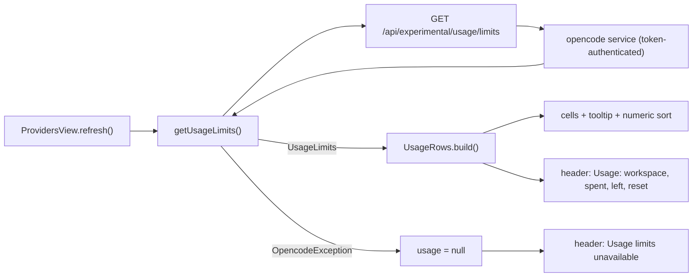

# System: the usage-limits surface — budgets, spent and left per model (T-152, gap G4)

## About this document

- **Kind:** `doc` / system definition — artifact of ticket `T-157` (stage `system`, basis `T-152`).
- **Read by:** the architecture/design stages downstream, the paired test-system ticket `T-158`,
  the engine review pass, and the maintainer; **written by:** the `T-157` fulfillment run (stage
  skill `software-system`).
- **Related:** `docs/tui-visible-surface-review.md` §4b (the governing verbatim-TUI-wording table,
  T-150 artifact), `docs/feature-matrix.md` and `docs/opencode-v2-adoption.md` (the landed T-152
  rows), the basis ticket `T-152` (requirements this system satisfies), git commit `ea7c7b1`
  (the implementation this document describes).

## Overview

The usage-limits surface is **one external interface plus four in-process parts that turn it into
honest words in the Providers view**: a client verb fetches `GET /api/experimental/usage/limits`,
a contract model parses the workspace budgets and carries the TUI's own wording over them, a
SWT-free projection decides which model row gets which cell, the view renders cells, tooltip and
header — and a degradation lane guarantees that a refusal or an absent route produces
`Usage limits unavailable` and empty cells, never a number the server did not hand over. It
satisfies `T-152` AC1 (the live-probed interface), AC2 (budget / spent / left per model in the
TUI's wording, honest absent states) and AC3 (a contract-tested verb), and the wording contract of
`docs/tui-visible-surface-review.md` §4b. This document fixes the system's parts, its interface and
its degradation rules; internal library boundaries and dependency rules belong downstream to
`software-architecture`.

## Major Parts

- **Client verb — `getUsageLimits`** (`eclipse/bundles/com.opencode.ide.client/src/main/java/com/opencode/ide/client/OpencodeClient.java`,
  implemented in `.../internal/HttpOpencodeClient.java`): `GET /api/experimental/usage/limits`,
  the v2 envelope (`{location, data}`) unwrapped like every other resource route, returning a
  typed `UsageLimits` or **throwing** — never a partial value. The interface default throws
  `UnsupportedOperationException` (test fakes stay minimal), so an unimplemented client also
  degrades instead of inventing data.
- **Contract model — `UsageLimits`** (`.../client/model/UsageLimits.java`): the probed response
  shape as records (`Workspace`, `Budget`, `BudgetModel`) plus the derived per-model types
  (`Limit`, `ModelUsage`) and the TUI wording ports: `formatDollars`, `formatReset`, `leftLabel`,
  `scopeLabel`, `modelUsage`, `summary`, `servedByConsole`, `NO_LIMITS`. This is the single place
  where what a budget *means* and how it *reads* live — the view never does its own arithmetic or
  its own wording.
- **View projection — `UsageRows`** (`eclipse/bundles/com.opencode.ide.ui/src/main/java/com/opencode/ide/ui/model/UsageRows.java`):
  the SWT-free pairing of the loaded `UsageLimits` with the view's model rows and the providers'
  `integrationID` map. Per model key (`<providerID>/<modelID>`) it produces the three cells
  (columns 7/8/9: Budget, Spent, Left), their numeric sort values and the scope tooltip — or **no
  entry at all** when no budget covers that model.
- **View surface — `ProvidersView`** (`.../ui/views/ProvidersView.java`): the `Budget` / `Spent` /
  `Left` columns with the TUI scope line as cell tooltip, the dialog description in the view
  header (`Usage: …`), the lenient load that catches any verb failure, the numeric sort with
  uncovered models last (`ModelComparator.setUsage`), and the `providers` intercept line carrying
  the rendered evidence (`usage-limits=… cells=N/M error=…`).
- **Degradation lane (refusal / absent)** — the cross-cutting part the two halves above form
  together: the verb *throws* on any refusal, the view *catches* and renders
  `Usage limits unavailable` with an empty projection. No third behavior exists (no sentinel
  values, no defaults, no zeros standing in for unknown).



## Technology choices

The surface adds **no new technology** — it is a slice of the existing Eclipse client stack:

| Concern | Choice | Why |
|---|---|---|
| Contract model | Java `record`s + Gson `@SerializedName` | already the client's wire-parsing stack; records keep the probed shape literal |
| Wording | static ports of the upstream TUI helpers | wording parity is a testable contract, not a formatting concern in the view |
| Projection | plain Java map, SWT-free | unit-testable without a display; the view only reads it |
| Surface | SWT/JFace virtual table columns | the Providers view's existing table mechanics |
| Persistence | none | budgets are fetched on each view refresh; no cache to go stale |

## Interfaces

### External: `GET /api/experimental/usage/limits`

- **Direction:** Eclipse client → local opencode service (the same base URL and `/api` route space
  as every other verb). **Auth:** rides the normal `/api` token — the probe recorded **HTTP 200
  with a token, HTTP 401 without one**, exactly like every other `/api` route.
- **Response envelope:** `{location:{directory:"…"}, data:{workspace, budgets:[…]}}` — a resource
  *object* under `data`, unwrapped by the shared parse path. The probed body (local 2.3.0,
  2026-11-17, pinned verbatim by the component test):

```json
{"location":{"directory":"..."},
 "data":{"workspace":{"id":"wrk_...","name":"Default",
          "usageURL":"https://opencode.ai/console/.../activity/overview"},
  "budgets":[{"id":"rule_legacy_budget_...","limit":100,"spent":0,"scope":"each",
              "per":"set","coverage":"all","models":[],"vendors":[],"picked":false,
              "shared":false,"resetsAt":1796083200000}]}}
```

- **Field semantics** (the contract model's vocabulary):

| Field | Meaning |
|---|---|
| `workspace.id` / `name` / `usageURL` | where the budgets live; the workspace name feeds `Usage: Workspace: <name> …`; `usageURL` is the console page behind the upstream "open usage console" link |
| `limit` / `spent` | budget size and spend in **USD**; `left` is derived client-side as `max(0, limit - spent)` — the server sends no `left` field |
| `scope` | who spends from the budget: `each` (only the user) vs shared |
| `per` | whether spend counts per model (`model`) or pooled as a set (`set`) |
| `coverage` | which models it covers: `all` (empty `models`/`vendors` = **every** model) or an explicit `models` list |
| `models[]` | model-scoped entries: `providerID`, `modelID`, `name`, per-entry `spent` (counted only when `per` is `model`) |
| `vendors[]` / `inputPriceAtLeast` | vendor-family / input-price-floor selectors for set coverage |
| `picked` / `shared` | selector flags; `shared` feeds the scope line's "who" |
| `resetsAt` | reset time as **epoch milliseconds** (fed to `formatReset`) |

- **Refusals and malformed answers — every one throws `OpencodeException`, none returns a value:**

| Cause | Observable failure | Oracle |
|---|---|---|
| HTTP 404 (a build without the experimental route) | message contains `HTTP 404` | `aMissingRouteThrowsInsteadOfReportingZeroBudgets` |
| HTTP 401 (no token) | message contains `HTTP 401` | `anUnauthenticatedAnswerThrowsInsteadOfInventingNumbers` |
| HTTP 200 with a non-JSON body | `malformed response body: …` | `aMalformedBodyThrows` |
| Empty body / JSON `null` payload | `empty response body …` / `JSON null response` | shared parse path (`parseBody`) |
| Interface default (no implementation) | `UnsupportedOperationException` | declared on `OpencodeClient` |

### Internal seams (part to part)

- `getUsageLimits` → `UsageLimits`: a **typed value or an exception**; nothing else crosses.
- `UsageLimits` → `UsageRows.build(limits, rows, integrations)`: the contract plus the view's rows
  plus the provider→`integrationID` map; out is a `Map<String, UsageRows.Row>` keyed
  `<providerID>/<modelID>` — or an empty map when nothing was loaded.
- `UsageRows` → `ProvidersView`: `cell()` (text), `sortValue()` (numeric, `null` = no usage),
  `scope()` (tooltip) per column 7/8/9; the header line comes from `UsageLimits.summary()`.
- `ProvidersView` → evidence: the `providers` intercept records the rendered header, the covered
  /total cell counts and the verb error message (desktop-safe verification channel).

## Degradation rules (honest degradation)

1. **Refusal throws, it never converts.** 404 / 401 / malformed / empty / `null` payloads all end
   in `OpencodeException`; there is no code path that turns a failure into an empty budget list.
2. **The load is lenient.** `ProvidersView.refresh()` calls the verb inside `try { … } catch`;
   a failure stores `usage = null` plus the message, and the providers table still renders — the
   usage lane can never take the view down.
3. **Nothing loaded → no numbers anywhere.** `summary(null)` is `null`, so the header segment
   reads exactly `Usage limits unavailable`, and the projection is empty (all three columns blank).
4. **Uncovered models get an *empty* cell, never `0` / `$0`.** A model is uncovered when it is
   free (every price tier zero), when no budget names it, when an all-coverage budget would have
   to touch a model the workspace cannot bill (provider not console-served, or integration data
   unknown — the honest default), or when no budgets were loaded at all. An empty cell means
   "not applicable", `$0` means "the server said zero" — the surface never confuses them.
5. **Zero is only ever server-given.** A loaded workspace with no budgets renders the TUI's
   own empty-state sentence (`NO_LIMITS`: "No limits apply to your models. Paid models stop only
   if the workspace runs out of credits.") inside `Usage: Workspace: <name> · <sentence>` — the
   one place zeros appear, because the server asserted them.
6. **Binding-limit rule.** When several budgets cover one model, the limit closest to running out
   (`left` ascending) is *binding* and supplies all three cells plus the `$X left` / `Limit
   reached` label, so Budget / Spent / Left always belong to one rule; `reached` is set when any
   covering limit is spent to its cap, and the reset shown is the earliest of them.
7. **Sorting admits ignorance.** In a usage column, models without a value sort **last in both
   directions** — they carry no number, so they are not handed a position a direction flip would
   fake.

## Wording contract (governing: `docs/tui-visible-surface-review.md` §4b)

§4b's `usage.show` row is the requirements source; the landed surface matches it verbatim:

| §4b wording (verbatim) | Where the system renders it |
|---|---|
| `$100` / `$0` / `$100 left` / `Limit reached` | `Budget` / `Spent` / `Left` cells via `formatDollars` + `leftLabel` |
| `Usage: Workspace: Default · $0 used of $100 · $100 left · Resets Nov 30` | the view header, via `UsageLimits.summary` |
| `Only you · All models` (the TUI scope line) | the cell tooltip, via `scopeLabel` |
| a model no budget covers renders an **EMPTY cell** | `UsageRows.build` omits the key → `cell()` returns `""` |
| a refused/absent route renders `Usage limits unavailable` — never a fabricated number | header segment when `summary` is `null` |

The wording helpers are direct ports of the upstream TUI (`packages/tui/src/util/usage-limits.ts`
and `packages/tui/src/component/usage.tsx`, read 2026-11-17), pinned by `UsageLimitsTest`:
`formatDollars` (`$100`, `$9.96`, `<$0.01`), `formatReset` (`Nov 30`, `Dec 25, 1:45 PM`,
`9:05 AM today`), `leftLabel` (`$100 left`, `Limit reached`, nothing while plenty is left),
`scopeLabel` (`Only you · All models`, `Everyone in <workspace> · All models`, `You and others`,
and the vendor clause `Only you · All <vendor> models`), and `summary`
(`Workspace: Default · $0 used of $100 · $100 left · Resets Nov 30`; `summary(null)` → `null`).
Numbers format through `Locale.US`/`Locale.ROOT` so the rendering is deterministic on every
machine.

## Verification oracles

This document describes only behavior these tests already assert — any conflict is a defect in
this document, not in the code:

- **`HttpOpencodeClientT152ComponentTest`** (5 green) — the verb over real HTTP against a stub:
  the probed shape (workspace + budgets fields), the model-scoped variant (`scope`/`per`/`coverage`
  selectors, `inputPriceAtLeast`, per-entry `spent`), and the three refusals (404, 401, malformed).
- **`UsageLimitsTest`** (22 green) — every wording string and the per-model projection: dollars,
  resets, labels, `servedByConsole` gating, free models, binding limit, reached state,
  no-budgets-null, scope lines and the summary line.
- Supporting: `UsageRowsTest` (cell / tooltip / sort-value projection, empty-on-unloaded) and
  `ModelComparatorTest` (numeric sort, uncovered models last in both directions).

## Coverage (upstream ids addressed)

- `T-152` AC1 — the live-probed interface (§Interfaces: response shape, 200/401 auth behavior).
- `T-152` AC2 — budget / spent / left per model in the TUI's wording, honest absent states
  (§Major Parts, §Degradation rules, §Wording contract).
- `T-152` AC3 — the contract-tested verb (§Verification oracles).
- `docs/tui-visible-surface-review.md` §4b `usage.show` row — quoted element by element in
  §Wording contract.

## Key trade-offs / open questions

- **Feature availability is answered by degradation, not by version probing.** The route is
  experimental (it answers 404 on older builds); the system treats a 404 as the normal absent
  answer it is — `Usage limits unavailable` — instead of gating on a build number.
- **No cache.** Budgets are fetched on every view refresh, so the header and cells are at most
  one refresh stale; a cache would need an invalidation story the surface does not need yet.
- **`usageURL` is parsed but not rendered.** The contract carries the console page URL, and the
  upstream dialog offers an "open usage console" link; the Eclipse surface has no link target for
  it yet — carried, unused, recorded (not a defect).
- **`picked` is carried, unconsumed** by this surface (a selector flag the wording does not use).
- **Vendor / price-floor scope wording is ported but rarely exercised** — it renders only when the
  server sends `vendors` / `inputPriceAtLeast`, which the probed workspace did not; the code path
  is unit-covered, the live shape is not.
